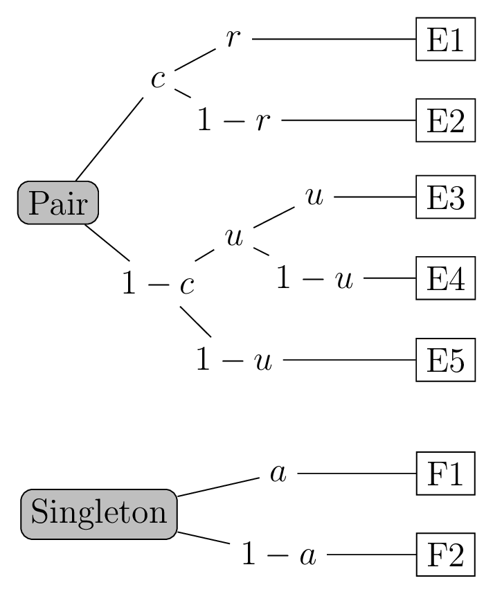

```{r}
#| echo: false
library(knitr)
```
## Install library

This exercise requires the package/library `mpt`. You need to install the library once on your computer. To do this, you please run the following code, once on the console (copy & paste)

`install.packages("mpt")`

## Maximum Likelihood Estimation


### Exercise 1: Number estimation experiment

We tested 10 children in the age of 6 years and asked them to count an array of dots. The arrays contained between 2 and 20 dots. The children were about 6 years old.

We hypothesized that 6 year old children can count up to a particular number. Until that number they can count rather precisely, but after that number they start to guess and say just the largest number known.

```{r}
#| echo: false
number = c(2,3,4,5,6,7,8,9,10,11,12,13,14,15,16,17,18,19,20,
2,3,4,5,6,7,8,9,10,11,12,13,14,15,16,17,18,19,20,
2,3,4,5,6,7,8,9,10,11,12,13,14,15,16,17,18,19,20,
2,3,4,5,6,7,8,9,10,11,12,13,14,15,16,17,18,19,20,
2,3,4,5,6,7,8,9,10,11,12,13,14,15,16,17,18,19,20,
2,3,4,5,6,7,8,9,10,11,12,13,14,15,16,17,18,19,20,
2,3,4,5,6,7,8,9,10,11,12,13,14,15,16,17,18,19,20,
2,3,4,5,6,7,8,9,10,11,12,13,14,15,16,17,18,19,20,
2,3,4,5,6,7,8,9,10,11,12,13,14,15,16,17,18,19,20,
2,3,4,5,6,7,8,9,10,11,12,13,14,15,16,17,18,19,20)
estim = c(1,4,4,6,7,8,9,9,10,13,12,12,14,11,11,10,9,13,12,1,3,5,5,7,7,10,9,11,
10,9,6,10,8,13,10,12,10,10,3,4,5,6,6,7,8,8,11,13,13,10,9,8,12,12,14,11,11,2,4,
5,6,8,8,8,11,10,5,10,7,10,12,8,12,14,15,14,1,3,3,5,7,7,9,9,9,12,7,10,10,10,11,
11,9,16,12,2,5,5,5,6,8,10,9,10,8,10,8,9,13,10,11,7,10,8,2,5,5,6,5,7,10,8,10,5,
13,10,12,10,11,12,11,13,8,2,2,6,6,6,6,8,10,10,10,8,10,12,7,12,13,12,8,10,1,2,
5,5,5,6,8,9,12,5,7,15,10,8,11,16,14,13,6,6,4,3,5,6,7,10,9,10,12,11,9,10,9,10,
11,11,7,10)
number_estim_data = data.frame(number, estim)
```

```{r}
head(number_estim_data)
```
The plot shows how the data look like, that is, the children's responses are distributed across the different numbers. The x-axis represents the actual number of dots, while the y-axis represents the children's estimations.

```{r}
#| echo: false
plot(jitter(number_estim_data$number, 1.5), number_estim_data$estim, pch = 19,
     xlab = "number of dots", ylab = "childrens' response")
```

**Question**: Look at the plot. The hypothesis above that children can count up to a particular number and then guess, can be modelled as a two linear regressions. If you have to draw two linear regressions to the data. How would you do that?

**Solution**:

```{r}
#| echo: false
plot(jitter(number_estim_data$number, 1.5), number_estim_data$estim, pch = 19,
     xlab = "number of dots", ylab = "childrens' response")

lines(c(0, 10, 10, 20), c(0, 10, 10, 10), col = "blue", lwd = 4)
```
<!-- end of solution -->

**Question**: How would you model the hypothesis above?

**Answer**: By two linear regressions and a cut-off point. The e second linear regression has a "slope of 0". The cut-off point is the number that children can count to.

### Exercise 2: Modelling Counting Data

We now want to model to the data and estimate the parameters of the model using maximum likelihood estimation (MLE).

First we have a "number knowledge model", which has the parameter

* $k$: the knowledge, the number that child can count to
* $b$: rate of counting, that is, the slope  between real and estimated numbers
* $x$ is the number of dots presented to the children

Our mathematical model looks than like this:
$$
\text{response} = \begin{cases} b * x & \text{if } x \leq k \\ k & \text{if } x > k \end{cases}
$$

or as _R_-code:

```{r}
number_knowledge_model <- function(k, b, x) {
    ifelse(x <= k,
           b * x, # if x<=k
           k  # if x>k
    )
}
```

Let use a maximum likelihood estimation (MLE) approach to estimate the parameters of our model. As in practical session 3, we want to use `optim()` to find the parameters that fit our model to the data. To do so, we have to defined the function to be optimized, which is the log-likelihood function.

For the maximum likelihood estimation, we need to assume that the errors (**residuals**) are normally distributed with mean 0 and standard deviation sigma  $\sigma$. We can then use the `dnorm(mean, sigma)` to calculate the log-likelihood of the data (The details of this methods are not relevant at this point).

It's just important to understand that the MLE estimation procedure not only models/estimates the parameter for the model ($k$ and $b$), but also the standard deviation for the error distribution.

Note: the `optim()` function always finds the minimum of a function, that is, if we want to use the function to **maximize** the log-likelihood, we need to **minimize the negative log-likelihood**. The (negative) log-likelihood for the linear regression model can be defined as follows:

We know defined the log-likelihood function for the model. The log-likelihood function is defined as follows:


```{r}
neg_loglik <- function(params, data) {
  k = params[1]; b = params[2];
  log_sigma =  params[3];

  predicted = number_knowledge_model(k, b,  data$number)
  residuals = data$estim - predicted

  # calculates the log-likelihood of the residuals under the normal distribution assumption
  loglik = sum(dnorm(residuals, mean = 0, sd = exp(log_sigma), log = TRUE))

  return(-loglik)  # return negative log-likelihood
}
```

We can now use the `optim()` function to maximize the log-likelihood function (minimizing the negative log-likelihood) and estimate the parameters of the linear regression model:

```{r}
fit_mle <- optim(par = c(k = 2, b=1, log_sigma = 0), hessian = TRUE,
                    fn = neg_loglik, data = number_estim_data)
fit_mle$par
```

Note:  `hessian = TRUE` is need as it allows us later to calculate the standard errors of the estimates. We will see that in a moment.

**Question**:

Interpret the finding of the estimated parameters.

**Answer**: The first parameter is the estimated number they can count to ($k$), $b$ is the count slope, and the third parameter is the log of the estimated standard deviation $\sigma$ of the error distribution. It shows that the children can count to about 10 (see $k$). The slope of about 1 show that children count correctly until 10 and after ten, there is no number knowledge and the children just guess.


### Exercise 3: Calculate Errors and Confidence Intervals

To get the standard deviation of the error distribution, we need to exponentiate the third parameter, the `log_sigma`, which is the log of the standard deviation $\sigma$:

```{r}
exp(fit_mle$par[3])
```

We can also calculate the standard errors of each estimate like this:
```{r}
se = sqrt(diag(solve(fit_mle$hessian)))   # standard errors of the estimates
```

This allows us to calculate the lower and upper boarder of the 95% confidence intervals for the estimates:

```{r}
lower = fit_mle$par - 1.96 * se
upper = fit_mle$par + 1.96 * se
cbind(fit_mle$par, lower, upper)
```

**Question**: Interpret the confidence intervals. What do they tell us about the estimates?

**Answer**: The confidence intervals give us a range of values within which we can be 95% confident that the true parameter values lie. If the intervals include zero, it suggests that the corresponding parameter may not be significantly different from zero. Overall, we can see that the confidence intervals are rather small, thus, the estimates are rather precises.


### Exercise 4: Calculate AIC

We have optimized for the negative log-likelihood, $-\log L$. The resulting   $\log L$ is:

```{r}
-1 * fit_mle$value
```

Calculate the AIC. You can find the formula in the slides:

**Solution**:
$$AIC = −2·\log L + 2k$$

```{r}
ll = -1 * fit_mle$value   # log-likelihood
k = 3                     # k, b, log_sigma
AIC = -2 * ll + 2 * k
print(AIC)
```
<!-- end of solution -->

### Exercise 5: Calculate BIC

Calculate the BIC. You can find the formula in the slides:

**Solution**:
$$BIC = −2·\log L + k·\log(n)$$

```{r}
n = nrow(number_estim_data)  # number of observations
print(n)
BIC = -2 * ll + k * log(n)
print(BIC)
```
<!-- end of solution -->


### Exercise 6: Alternative model

Another way to model the data is the assume that children have different counting rates of single and double digit numbers. That is, we can assume that children have a different slope for numbers $<=10$ and number $>10$.

That is, we do not estimate $k$, but two slopes, $b_1$ and $b_2$. The model looks than like this:
$$
\text{response} = \begin{cases} b_1 * x & \text{if } x \leq 10 \\ b_2 * x & \text{if } x > 10 \end{cases}
$$


**Question**: Try to model this data. You can use the following template and fill in the blanks `...`


```{r}
#| eval: false
number_knowledge_model2 <- function(b1, b2, x) {
  ...
}

neg_loglik2 <- function(params, data) {
  ...

  predicted = ...
  residuals = ...

  # calculates the log-likelihood of the residuals under the normal distribution assumption
  loglik = sum(dnorm(residuals, mean = 0, sd = exp(log_sigma), log = TRUE))
  return(-loglik)  # return negative log-likelihood
}
fit_mle2 = optim(par = c(...), hessian = TRUE,
                    fn = ..., data = ...)
fit_mle2$par
```

**Solution**

```{r}
number_knowledge_model2 <- function(b1, b2, x) {
    ifelse(x <= 10,
           b1 * x, # if x<=10
           b2 * x  # if x>10
    )
}

neg_loglik2 = function(params, data) {
  b1 = params[1]; b2 = params[2];  log_sigma =  params[3];

  predicted = number_knowledge_model2(b1=b1, b2=b2,  data$number)
  residuals = data$estim - predicted

  # calculates the log-likelihood of the residuals under the normal distribution assumption
  loglik = sum(dnorm(residuals, mean = 0, sd = exp(log_sigma), log = TRUE))
  return(-loglik)  # return negative log-likelihood
}
fit_mle2 = optim(par = c(b1 = 1, b2 = 1, log_sigma = 0), hessian = TRUE,
                    fn = neg_loglik2, data = number_estim_data)
fit_mle2$par
```
<!-- end of solution -->


### Exercise 7: Model Comparison

Calculate the AIC and BIC of the new model and compare it to the first model. Which model is better?

**Solution**:
```{r}
ll2 = -1 * fit_mle2$value   # log-likelihood
k2 = 3                     # b1, b2, log_sigma
AIC2 = -2 * ll2 + 2 * k2
print(AIC2)

n = nrow(number_estim_data)  # number of observations
BIC2 = -2 * ll2 + k * log(n)
print(BIC2)
```

The AIC and BIC of the first model were smaller than the AIC/BIC of the second model. Thus, the first model fits better the data.
<!-- end of solution -->

## Multinomial Processing Tree Models

### Experiment by Riefer & Batchelder (1988)

The experiment by Riefer & Batchelder (1988) is a classic example of a memory experiment. In this experiment, participants were presented with a list of words and were later asked to write down all the words they remembered (free recall). The researchers were interested in understanding the cognitive processes involved in memory retrieval. (see the slides 33pp of lecture 7).

The remembered words and their order of recall can be categorized  as follows:

* *Category pairs*
  * **E1** Pair is recalled adjacently ("aunt – uncle")
  * **E2** Pair is recalled non-adjacently ("aunt – cow – uncle")
  * **E3** One word in a pair is recalled
  * **E4** Neither word in a pair is recalled
* *Singletons*
  * **F1** Recall of a singleton
  * **F2** Non-recall of a singleton


#### Theoretical Considerations
Based on our "paired-cluster" theory of Human memory, we assume that we can distinguish between the following cognitive processes:

* $c$: storing a word pair (during the study phase)
* $r$: retrieving a stored word pair
* $u$: retrieving unclustered single word
* $a$: retrieving a singleton

#### Mathematical Model

The multinomial processing tree model can be represented mathematically as follows:

{width=50%}


### Exercise 8: The data


Let's read in the data

```{r}
dat_text = "
treeid resp freq
  1     E1   132
  1     E2   19
  1     E3   147
  1     E4   502
  2     F1   166
  2     F2   634
"
dat = read.table(text=dat_text,
                  header = TRUE)
```

**Question**: Look at the data.There is big difference between **E1** and **E2**. And also between **E3** and **E4**. What could this indicate about the cognitive processes?

**Answer**: The difference between **E1** and **E2** indicates that the retrieval of a word pair is more likely to be adjacent  than no-adjacent. This points to the process that word pair are most often stored in memory as a semantically related pair and not as two single word. The difference between **E3** and **E4** suggests that if a word pair is not stored, it is more likely to recall nothing than recalling one of the words in the pair. This also points to the importance of the storing process.

### Exercise 9: Modelling the data

Before start modelling the data we need to load the required library for multinomial processing tree models.

```{r, message=FALSE}
library("mpt")
```

Our "paired-cluster" model looks like this as _R_ code:

```{r}
md_pair_clst <- mptspec(
  # Pair Tree
  c * r,
  (1-c) * u * u,
  (1-c) * u * (1-u) + (1-c) * (1-u) * u,
  c * (1-r) + (1-c) * (1-u) * (1-u),
  # Singelton Tree
  a,
  (1-a)
)
```

Model fitting is simple with the `mtp` library.

```{r}
md_fit1 = mpt(md_pair_clst, dat)
print(md_fit1)
```

**(a)**: How many free categories are there in the model?

**(b)**: What are the degrees of freedom for the model?

**(c)**: Is the model identifiable, unidentifiable or saturated?

**Solution**

```{r}
nobs(md_fit1)  ##  J = 2, number of free categories
```
```{r}
df = nobs(md_fit1) - 4 ## we have 4 parameter
print(df)
```

With $df=0$ is model is saturated. That is, we can not calculate
$\chi^2$-test or interpret the model fit.
<!-- end of solution -->

### Exercise 10: Restricted Model

We make a restricted model by assuming that the probability retrieving unclustered single word ($u$) is equal to the probability of  retrieving a singleton ($a$). That is, we assume $u=a$.

With `mpt`you create a restricted model like this:

```{r}
md_restr = update(md_pair_clst, .restr = list(u=a))
```

**(a)**: What is the advantage or purpose of making a restrided model?

**Answer**: The advantage of making a restricted model is that by imposing constraints on the parameters, we can reduce the number of free parameters in the model and thus increase the $df$. The model can be then tested for goodness of fit.

**(b)**: Fit the restricted model in _R_.

```{r}
#| echo: false
# fitting need for later question
md_fit2 = mpt(md_restr, dat)
```

**Solution**:
```{r}
md_fit2 = mpt(md_restr, dat)
print(md_fit2)
```
<!-- end of solution -->

### Exercise 11: Interpret Model Fit

Look at the $\chi^2$-test of the restricted model. What is $p$-value of the $\chi^2$-test tell us? Is the model a good fit to the data?

**Answer**: The $p$-value of the $\chi^2$-test is very large, which shows that the predicted and observed frequencies are not significantly different. In other words, the model predicts the data rather good. The model does fits the data well. The model can be therefore accepted.

### Exercise 12: Interpret the parameter estimates

run `summary(md_fit2)` and interpret the parameter estimates

**Solution**

```{r}
summary(md_fit2)
```

<!-- end of solution -->

### Exercise 13: Likelihood ratio test

If you run a likelihood ratio test, you can compare the restricted model to the unrestricted model. To do use we use the  _R_-function `anova()`. See:

```{r}
anova(md_fit2, md_fit1)  ## likelihood ratio test (order is important!)
```

**Question**: Interpret the output above. What does the likelihood ratio test tell us about the restricted model?

**Answer**: The likelihood ratio test shows that the restricted model is not significantly worse than the unrestricted model. This means that the restriction we imposed (that $u=a$) does not significantly reduce the fit of the model to the data. Therefore, we can conclude that the assumption that the probability of storing a word pair is equal to the probability of retrieving a word pair is reasonable given the data.

### Exercise 14: Another Restriction

Hypothesis: Retrieving a stored word pair is the same as retrieving a singleton. That is, $r=a$.

**(a)** Make a restricted model `md_restr2` to test this hypothesis.

That is, create a restriced model (`md_restr2`) from the `md_pair_clst`and test if the hypothesis holds using a likelihood ratio test comparing unrestricted model `md_pair_clst`  with `md_restr2`.

**Solution**:

```{r}
md_restr2 = update(md_pair_clst, .restr = list(r=a))
md_fit3 = mpt(md_restr2, dat)
anova(md_fit3, md_fit1)  ## likelihood ratio test (order is important!)
```

<!-- end of solution -->

**(b)**: Interpret the output of the likelihood ratio test.

**Answer**: The likelihood ratio test shows that the restricted model is significantly worse than the unrestricted model. This means that the restriction we imposed (that $r=a$) significantly reduces the fit of the model to the data. Therefore, we can conclude that the assumption that the probability of retrieving a stored word pair is equal to the probability of retrieving a singleton is not reasonable given the data.

