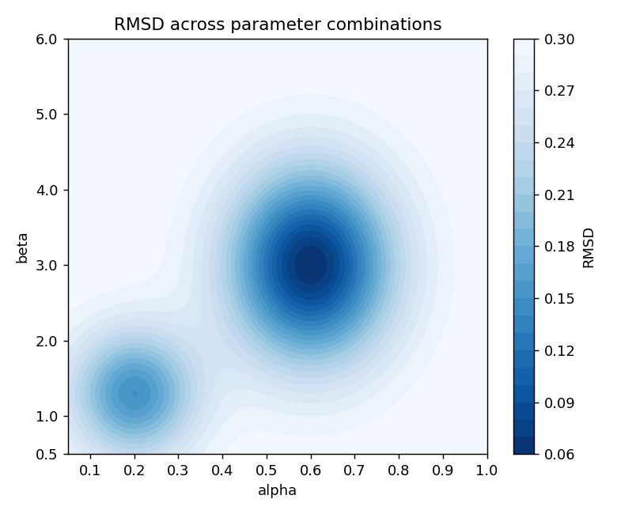

Find below some practice questions for the course *Data Science 2026/2027*. Answers are at the end of this document.

--------------------

The actual exam will comprise

* 30 **multiple choice questions** testing primarily your theoretical
knowledge and the content that we have discusses in the lectures. You get one point for each correctly
answered question.
* 4 to 6 **open practical questions**  testing your R programming skills. Practical
questions are open questions and might required multiple steps/answers to solve. You can
therefore get sometimes more than one point. Partial points are possibles.

The final grade of the exam will be based

* 80% ($4/5$) on the theoretical MC questions and
* 20% ($1/5$) on the practical open questions.

--------------------


# Multiple Choice Questions


## Q1

What does resampling mean?

a) Collecting a new sample from the population each time.
b) Repeatedly drawing or rearranging samples from existing data to study a statistic or its uncertainty.
c) Generating data only from a normal distribution.
d) Artificially generating new data based on the mean and standard deviation


## Q2

Computer-based random number generation is based on a starting value that the software uses for making a list of numbers that look random. This starting value is called a:

a) Starting point
b) Key
c) Anchor point
d) Seed


## Q3

The figure below shows an RMSD cost surface across a grid of
`alpha` and `beta` values (darker = lower RMSD = better fit). Based on
this figure, which of the following is the **global** minimum (i.e., the
single best-fitting parameter combination)?

{width="70%"}

a)  alpha ≈ 0.6, beta ≈ 3
b)  alpha ≈ 0.2, beta ≈ 1.3
c)  alpha ≈ 0.9, beta ≈ 5.5
d)  alpha ≈ 0.6, beta ≈ 0.5

## Q4

Which of the following is an example of supervised learning?

a)  A model is given 10,000 photos without labels and groups them into
    clusters of similar-looking images\
b)  A model's parameters are adjusted to minimize the RMSD between its
    predictions and the observed responses, where every stimulus comes
    with a recorded response\
c)  A robot learns a route through a maze only from the reward it
    receives at the exit\
d)  A model reduces each image to 2 numbers so that it can be plotted,
    without using any information about what the images show

## Q5

A perceptron that receives inputs for roundness and elongation
has weights `w1 = 2` and `w2 = -2`, respectively, and a `bias = 0`. A
shape has roundness = 0.9 and elongation = 0.1. Approximately what
number does the perceptron output?

a)  0.17
b)  0.83
c)  1.6
d)  Category A

## Q6

What does the learning rate `η` (`lr`) control in the delta
rule?

a)  How big a step each weight takes once the direction and the amount
    of correction have been worked out
b)  Which weights get updated and which do not
c)  Whether the output is thresholded at 0.5
d)  How many training examples the network sees in total

## Q7

What is the main job of the hidden layer in a network that
solves XOR?

a)  It re-describes each input pattern as a new pair of numbers (the
    hidden-unit outputs), in which the two classes can be separated by a
    single straight line\
b)  It stores a copy of the training data, so that the output unit can
    look up the answer\
c)  It speeds up learning, but a network without a hidden layer could
    solve XOR just as well\
d)  It makes the sigmoid unnecessary, because hidden units use a linear
    function

## Q8

One training step on a single example consists of the following
four stages. Which is the correct order?

a)  Compute `delta_out`; run `forward()`; compute `delta_hidden`; update
    the weights\
b)  Run `forward()`; compute `delta_out`; compute `delta_hidden`; update
    the weights\
c)  Run `forward()`; compute `delta_hidden`; compute `delta_out`; update
    the weights\
d)  Run `forward()`; update the weights; compute `delta_out`; compute
    `delta_hidden`


## Q9

What is a Multinomial Processing Tree Model?

a) Statistical model for continuous data
b) Statistical model for categorical data
c) Statistical model for neural data
d) Statistical model for time series data


## Q10

If the degree of freedom of a mathematical model, such as a multinomial processing tree model, is smaller than zero ($df < 0$), the model is ________

a) not identifiable
b) saturated
c) insignificant
d) overfitted


# Open Practical Questions


## Q11

**Fill in the Blank. (1 point)**

This code should print `Pass` if `score` is at least 55.

```r
score <- 65

__________  {
  print("Pass")
}
```

Fill in the blank so that code runs correctly.


Your answer: __________________


## Q12

**What is the output? (1 point)**

You you have a vector `temperature` with five values.

```r
temperature = c(20, 10, 23, 35, 40)
```

What is the output of the following code?

```r
i = 3
temperature[2] + temperature[i]
```

Your answer: _________________


## Q13

**Find the bug. (1 point)**

The data frame data contains the following variables:

- contrast: the contrast level
- n_correct: the number of correct responses (out of 40)
- prop_correct: the proportion of correct responses (between 0 and 1)'

A student's `rmsd()` returns a value of about 30 for `alpha = 0.5`,
`beta = 2`, although the data are proportions between 0 and 1. Find the
bug and fix the line.

``` r
rmsd <- function(params, data) {
  alpha <- params[1]; beta <- params[2]
  predicted <- psychometric_model(alpha, beta, data$contrast)
  sqrt(mean((data$n_correct - predicted)^2))
}
```

Your answer: \_\_\_\_\_\_\_\_\_\_\_\_\_\_\_\_\_\_\_\_\_\_\_

## Q14

**Fill in the Blank. (3 points)**

Complete the code. At the end of each
training epoch, we want to calculate and store the RMSD between the
network's predictions and the correct categories for all four XOR
patterns.

- X is a 4 × 2 matrix containing the four XOR input patterns.
- y contains the correct category (target) for each pattern.
- pred will contain the network's prediction for each pattern.
- forward() returns a list containing the network's prediction as
  output.
- losses \<- numeric(n_epochs) has already been created to store one
  RMSD value for each epoch.
- epoch is the current epoch number.

Fill in the three blanks.

``` r
pred <- numeric(nrow(X))
for (i in 1:nrow(X)) {
  pred[i] <- forward(X[i, ], W1, b1, w2, b2)$___A___
}
losses[___B___] <- sqrt(mean((y - ___C__)^2))
```

Your answers

A: \_\_\_\_\_\_\_\_\_\_\_\_\_\_\_\_\_\_\_\_\_

B: \_\_\_\_\_\_\_\_\_\_\_\_\_\_\_\_\_\_\_\_\_

C: \_\_\_\_\_\_\_\_\_\_\_\_\_\_\_\_\_\_\_\_\_

------------------------------------------------------------------------

<p style='padding-top: 150ex'></p>

# Answers

- **Q1**: B
- **Q2**: D
- **Q3**: A - this well's RMSD bottoms out around 0.06. Option b is a
  deliberate trap: it's a genuine, visible local minimum (RMSD ≈ 0.15)
  just clearly shallower than the global one once you compare the two
  directly against the color scale, This tests the actual
  local-vs-global-minimum distinction from the lecture, not just "can
  you find a dark patch.
- **Q4**: B - this is the definition of supervised learning. a and d are
  unsupervised (no labels); c is reinforcement learning (reward only).
- **Q5**: B - `z = 2*0.9 + (-2)*0.1 + 0 = 1.6` and `sigmoid(1.6) = 0.83`.
  Distractor c is the weighted sum `z` before the sigmoid; a is the
  output for the mirror-image shape (roundness 0.1, elongation 0.9); d
  is the label you get *after* thresholding, not the number the
  perceptron outputs.
- **Q6**: A - Distractor b describes the input factor (door 1); c is
  unrelated; d is the number of epochs.
- **Q7**: A - XOR cannot be separated by a single line in the (x1, x2)
  plane, but it can in the (h1, h2) plane. Distractor c is exactly the
  claim that NN1 showed to be false.
- **Q8**: B - the forward pass must come first, then the output delta, then
  the hidden delta, then the weight update. Distractor a is the order of
  operations in the backward pass, but it omits the forward pass; c and
  d are just wrong.
- **Q9**: D
- **Q10**: A
- **Q11**: if (score >= 55)
- **Q12**: 33 - adding second and thrid value of the vector
- **Q13**: `data$n_correct` should be `data$prop_correct` - (counts such as
  16 to 40) is compared with predicted proportions.
- **Q14**: Answer A: `output`, B: `epoch`, C: `pred`. Note that `forward()`
  returns a list, so `$output` is needed, and `y - pred` is the
  discrepancy between target and prediction.)\*
